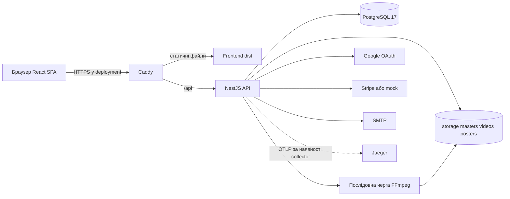

# Архітектура AbsoluteCinema

Стан коду на 05.11.2026. Джерела: РГР2 1.2.2, 3.1–3.2; ТЗ 4.2, 4.5. Деталі: [implementation-status.md](implementation-status.md).

## Контекст і контейнери

Гість, глядач і адміністратор працюють через браузер. Зовнішні системи — Google OAuth, Stripe та SMTP. React відображає інтерфейс; NestJS перевіряє доступ і виконує бізнес-логіку; PostgreSQL зберігає структуровані дані. Відео й зображення лежать у файловому сховищі, БД містить посилання на них.

Це один модульний backend, без мікросервісів, Redis, CDN чи S3. Черга перекодування й upload locks належать одному процесу. Джерело незавершеного перекодування зберігається в БД, стан докачування — на диску; вони відновлюються після restart, але не є розподіленою чергою. Горизонтальне масштабування потребуватиме окремого проєктування.

## Компоненти backend

| Модуль | Відповідальність | Файли від кореня репозиторію |
|---|---|---|
| auth | Реєстрація, login lock, JWT, reset, OAuth state/exchange/link | `backend/src/modules/auth/` |
| users | Профілі, ролі, блокування, видалення, subscription DTO | `backend/src/modules/users/` |
| media | Каталог, довідники, обране, оцінки, progress, events, Range | `backend/src/modules/media/media.service.ts` та контролери поруч |
| media uploads | Chunks, checksums, resume, фінальна перевірка | `backend/src/modules/media/uploads.service.ts` |
| media transcode | Черга, ffprobe, аудіо, renditions, поступова публікація | `backend/src/modules/media/transcode.service.ts`, `media-processing.ts` |
| payments | Checkout/webhooks, підписки, retries/expiry, тарифні ліміти | `backend/src/modules/payments/` |
| devices | Конкурентні слоти перегляду з TTL | `backend/src/modules/devices/` |
| recommendations | SQL content-based scoring та fallback | `backend/src/modules/recommendations/` |
| admin | Агрегати активності за період | `backend/src/modules/admin/` |
| mail | Welcome, reset, receipt | `backend/src/modules/mail/` |

HTTP controllers → services → TypeORM repositories/параметризований SQL. `AppModule` підключає модулі, конфігурацію, TypeORM та scheduler. `main.ts` задає `/api`, CORS, ValidationPipe, exception filter, logging і Swagger поза production. Медіаметадані додатково мають спільний parser `media-input.ts`.

JWT strategy знову читає користувача, `tokenVersion`, блокування та підписку з БД. `RolesGuard` перевіряє admin; `SubscriptionGuard` — оплачений доступ. Frontend guards потрібні для UX, авторитетна перевірка — на сервері.

## Компоненти frontend

`App.tsx` поєднує контексти авторизації, мови, теми, toast і завантажень. `routes/AppRoutes.tsx` задає маршрути. Сторінки використовують API через `services/`; `MoviePlayback` координує доступ/пристрої/історію, `VideoPlayer` керує HTML5 video. `UploadContext` і `uploadManager` підтримують upload під час SPA-навігації; Web Worker рахує хеші без блокування UI.

Публічні `/privacy` і `/terms` відображаються SPA та генеруються як статичні двомовні HTML із тих самих JSON. Це вузький build-time механізм для політик, не загальний SSR.

## Розгортання й дані

Локальний `docker-compose.yml` запускає лише PostgreSQL, Mailpit і Jaeger. API та Vite працюють через npm на хості. `deploy/compose.yml` запускає PostgreSQL, backend і Caddy/frontend; зовнішні порти — 80/443, окремі volumes — БД, медіа, Caddy data/config.

Сховище обчислюється від `process.cwd()`: стандартний npm-запуск backend використовує `backend/storage`, Docker — `/app/storage`. Існування кореневої `storage/` не означає, що API її використовує. Переміщення БД без media volume дає метадані без відео.

Схема керується сімома TypeORM-міграціями; `synchronize=false`. Таблиці playback/rating events і Google OAuth flows створені SQL-міграціями без окремих entities. [Модель даних](data-model.md) пояснює зв'язки, транзакції й міграції.

## C4-зображення

[Context](diagrams/C4_level1.png), [Containers](diagrams/C4_level2.png), [Components](diagrams/C4_level3.png) збережено як проєктні матеріали. Їх не переробляли й не перевіряли візуально в цьому проході; актуальний склад deployment, upload pipeline та OAuth описано текстом вище.
