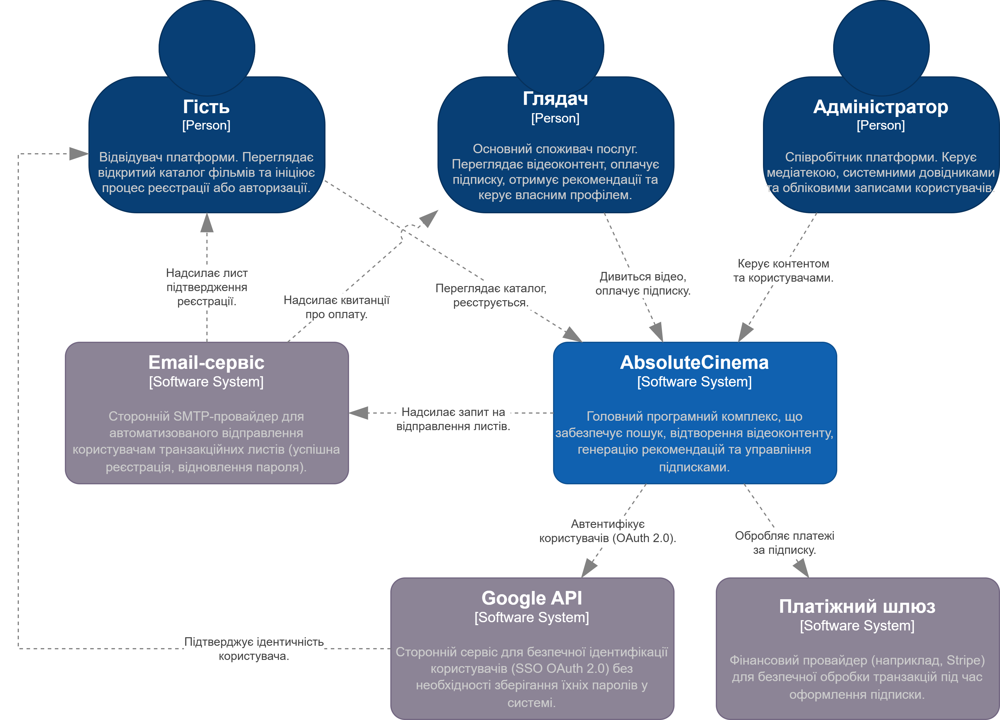
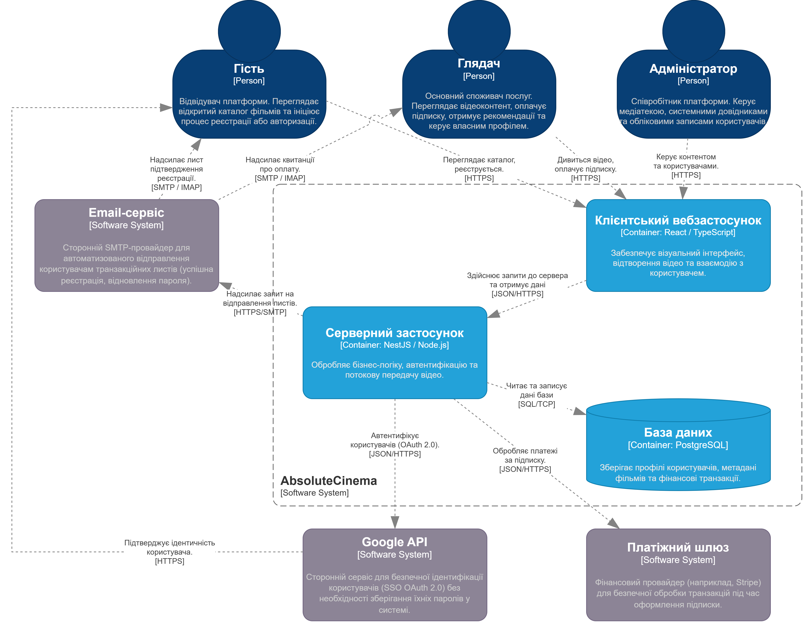
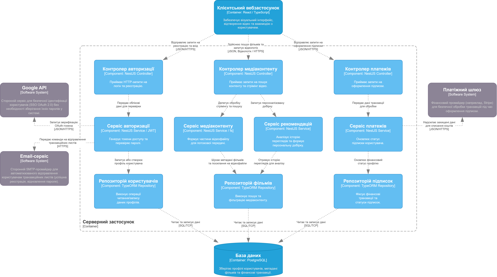

# System Architecture (C4 Model)

The system follows a separated **Client-Server Architecture** communicating over a secure **REST API**. The architecture is documented using the **C4 Model** (Context, Container, and Component levels).

---

## 1. Context Diagram (C4 - Level 1)

### Actors:
* **Guest [Person]:** Unauthenticated visitor. Browses public catalog, initiates registration or authorization.
* **Viewer [Person]:** Authenticated primary user. Streams video content, purchases subscriptions, receives recommendations, manages profile.
* **Administrator [Person]:** Platform employee. Manages media library, dictionaries (genres/actors), and user accounts.

### External Systems:
* **Google API [Software System]:** Identity provider for Single Sign-On via OAuth 2.0 (HTTPS).
* **Payment Gateway [Software System] (e.g., Stripe):** Handles secure payment processing for subscriptions (HTTPS).
* **Email Service [Software System]:** Third-party SMTP provider for automated transactional emails (welcome emails, password resets, payment receipts).

### Core System:
* **AbsoluteCinema [Software System]:** Central software system managing search, streaming, recommendations, authentication, and subscription lifecycle.

---

## 2. Container Diagram (C4 - Level 2)

The platform consists of three main containers:

1. **Client Web Application (`[Container: React / TypeScript]`):**
   * Executes in the user's browser (SPA).
   * Renders the dynamic UI, handles video playback controls, and captures user actions.
   * Communicates with backend via **JSON / HTTPS**.
2. **Server Application (`[Container: NestJS / Node.js]`):**
   * Central backend API node.
   * Encapsulates all business logic, authentication, recommendation algorithms, and video streaming endpoints (`HTTP Range Requests`).
   * Connects to external services (Google OAuth via JSON/HTTPS, Payment Gateway via JSON/HTTPS, Email Service via SMTP/HTTPS).
3. **Database (`[Container: PostgreSQL]`):**
   * Primary relational store for user profiles, movie metadata, and financial transactions.
   * Communicates with the server application via **SQL / TCP**.

---

## 3. Backend Component Diagram (C4 - Level 3)

The NestJS backend application is architected into three distinct layers:

### Layer 1: Controllers (HTTP Entrypoints)
* **Auth Controller (`[NestJS Controller]`):** Handles login, registration, SSO callbacks.
* **Media Controller (`[NestJS Controller]`):** Handles movie search requests, metadata retrieval, and video stream requests.
* **Payment Controller (`[NestJS Controller]`):** Handles subscription checkout, webhook events, and billing status requests.

### Layer 2: Services (Business Logic)
* **Auth Service (`[NestJS Service / JWT]`):** Validates credentials, manages password hashing, issues JSON Web Tokens, triggers email notifications.
* **Media Service (`[NestJS Service / fs]`):** Prepares video chunks for streaming (`HTTP Range Requests`), manages media assets.
* **Recommendation Service (`[NestJS Service]`):** Executes Content-Based Filtering based on viewing history and ratings.
* **Payment Service (`[NestJS Service]`):** Interacts with external Payment Gateway, validates transactions, and updates subscription state.

### Layer 3: Repositories (Data Access Layer - TypeORM)
* **User Repository (`[TypeORM Repository]`):** Handles CRUD operations on user entity records.
* **Movie Repository (`[TypeORM Repository]`):** Handles querying and persistence of movies, genres, and actor relations.
* **Subscription Repository (`[TypeORM Repository]`):** Manages financial transactions, billing logs, and active subscription intervals.
